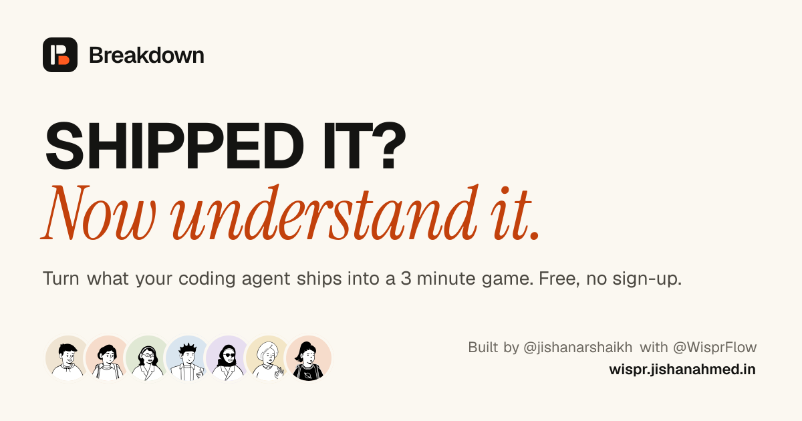

<p align="center">
  
</p>

<h1 align="center">Breakdown</h1>

<p align="center"><strong>SHIPPED IT? Now understand it.</strong></p>

<p align="center">
  <a href="https://wispr.jishanahmed.in">Live site</a> ·
  <a href="https://wispr.jishanahmed.in/learn">Learn from others</a> ·
  <a href="docs/architecture.md">Architecture</a> ·
  <a href="docs/demo/script.md">Demo script</a>
</p>

<p align="center">
  
</p>

Coding agents ship code in minutes. Breakdown turns each change they ship into a three minute
game, so you understand what the agent did and the engineering behind it, instead of merging code
you could not explain.

Live at [wispr.jishanahmed.in](https://wispr.jishanahmed.in). Built by
[@jishanarshaikh](https://x.com/jishanarshaikh) for No Hands: The Wispr Challenge
([WeMakeDevs](https://x.com/WeMakeDevs) and [Wispr Flow](https://x.com/WisprFlow), October 2026),
completely hands-free with Wispr Flow. Independent entry, not an official Wispr product.

## How it works

1. **The wire.** A news-style feed of recent pull requests and commits. Without GitHub it plays a
   clearly labelled sample wire. Plug in GitHub once (a read-only token kept in your browser) to
   see what you and your agents shipped. Or paste any public PR, commit or compare link, or a raw
   diff, into the search bar.
2. **Break it down.** Five rounds:
   - **Replay**: what the agent did, step by step, with the exact lines lighting up.
   - **Engineering**: two or three concept cards (for example "idempotency") you flip to unlock.
   - **Predict**: questions about how this exact code behaves. Every answer shows the real lines.
   - **Explain it back**: say it in your own words. With Wispr Flow you just talk. Key ideas
     light up as you cover them. Scored by keyword matching, not by AI.
   - **Score**: XP, levels, achievements and avatar unlocks.
3. **Drill down.** Tap any line to see where it is explained, or break down one file on its own.
   Big pull requests are covered most important files first; the rest are listed for file-by-file
   rounds.
4. **Show it.** When a breakdown ends, your card pops up with a **Post on X** button. The post
   links to your card on wispr.jishanahmed.in and credits the maker and Wispr Flow
   (`Built by @jishanarshaikh, completely hands-free with @WisprFlow`). Cards have 10 avatars
   (2 free, 8 to unlock), 3 templates and 5 taglines. Claim a name, unique across all players, to
   save progress and join the live leaderboard, which tells you when someone overtakes you. No
   sign-up, no email. A name can change once every 180 days.
5. **Learn from others.** At the end of a breakdown of a public GitHub change, you can turn on
   **Make this breakdown public**. It is off by default. Shared breakdowns appear on
   [/learn](https://wispr.jishanahmed.in/learn) and in the live feed with your name, and anyone
   can play them free. Make any of them private again from your card page. Private repositories,
   pasted diffs and samples can never be shared.

## Free and unlimited

- **2 AI breakdowns per hour per browser** on the shared key, so people sharing one WiFi each
  get their own. A network ceiling (20 an hour by default) stops one person minting more. The search bar shows how many are
  left and when the next one frees up. A breakdown that fails is not counted.
- **Public links someone already broke down are free.** Results are cached in Postgres: 30 days
  for a commit (it never changes), 6 hours for a pull request or compare (they can gain commits).
- **Samples and GitHub are always free.** Connecting GitHub only reads your own feed.
- **Bring your own key** (Groq, OpenAI, Anthropic or OpenRouter) in Settings for no hourly limit
  and bigger changes: up to 3,000 changed lines at once.

## Honesty rules

- Every step, concept and question must cite real lines of the diff. The server checks each
  reference and drops anything invented; if nothing grounded is left, the breakdown is refused.
- Sample changes and the sample wire are labelled as samples everywhere.
- Leaderboard numbers are self-reported by each browser and re-checked against the game rules.
  It is a game, not a certificate.
- Sharing is consent per breakdown. The server shares its own cached breakdown of a public
  GitHub link, never text the browser sends, so private code cannot be shared and shared text
  is real, grounded model output.
- The GitHub token is only sent to api.github.com. A player's own AI key is sent with each
  breakdown request and used for that one call; neither is stored or logged.

## Run it

Needs Node 22.13 or later.

```bash
npm ci
cp .env.example .env.local   # add GROQ_API_KEY for live breakdowns
npm run dev                  # http://localhost:3000
```

Without any keys the four sample breakdowns, the card and a local leaderboard (embedded PGlite)
all work. Live breakdowns need `GROQ_API_KEY`, or a player's own key added in Settings.

```bash
npm run check      # lint, typecheck, format check, unit and integration tests
npm run test:e2e   # Playwright on desktop and phone sizes (starts the dev server)
npm run verify     # check plus a production build
```

## Configuration

Every variable is validated in `src/server/config.ts`; error messages name the variable, never its
value.

| Variable                          | Required      | Purpose                                                         |
| --------------------------------- | ------------- | --------------------------------------------------------------- |
| `GROQ_API_KEY`                    | No            | Shared AI for breakdowns. Without it, samples and own keys only |
| `GROQ_MODEL`                      | No            | Default `openai/gpt-oss-120b`                                   |
| `BREAKDOWNS_PER_HOUR`             | No            | Free shared-key breakdowns per browser per hour. Default 2      |
| `BREAKDOWNS_PER_NETWORK_PER_HOUR` | No            | Ceiling per network per hour, against abuse. Default 20         |
| `DATABASE_URL`                    | In production | Hosted Postgres (Neon) for the leaderboard and saved progress   |
| `PGLITE_DIR`                      | No            | Where local PGlite keeps data. Default `.data/pglite`           |
| `LOG_LEVEL`                       | No            | `debug`, `info`, `warn` or `error`. Default `info`              |

The database migrates itself on the first request (`src/server/db/migrations.ts`). Migration
`b0002_drop_receipts` removes the archived Receipts tables from a shared database and leaves
`rate_limits` and Breakdown's own tables alone.

### Deploying on Vercel

1. Connect Neon in the Vercel dashboard (Storage). It sets `DATABASE_URL`.
2. Add `GROQ_API_KEY` under Settings, Environment Variables, for Production. Optional:
   `BREAKDOWNS_PER_HOUR`, `BREAKDOWNS_PER_NETWORK_PER_HOUR`, `GROQ_MODEL`, `LOG_LEVEL`.
3. Add the custom domain `wispr.jishanahmed.in`. Share links and images always use it.
4. Push to the production branch. The first request runs the migrations.

## Architecture

Next.js 16 (App Router, Cache Components), TypeScript strict, Tailwind CSS 4, Postgres through
postgres.js (Neon) or PGlite locally, Vitest and Playwright. See
[docs/architecture.md](docs/architecture.md) and [AGENTS.md](AGENTS.md).

## Known limits

- Live GitHub alerts only update while the page is open; there is no server holding your token.
- The free shared model has small request limits, so very large changes are split by importance
  and the remaining files are broken down one at a time.
- The share link carries the card's numbers, so anyone can make a card with any numbers. The
  leaderboard re-checks numbers against the game rules but cannot prove them.
- GitLab and Bitbucket are not connected yet.

## Credits

- Avatars: [DiceBear](https://www.dicebear.com) Notionists style (art CC0, code MIT), drawn once
  by `node scripts/avatars.mjs` and committed. Nothing is generated at runtime.
- Fonts in share images: Geist and Instrument Serif, SIL Open Font License (licences in
  `src/app/card/fonts`).
- Icons: [Lucide](https://lucide.dev) (ISC).
- Built hands-free with [Wispr Flow](https://wisprflow.ai) for the
  [WeMakeDevs](https://www.wemakedevs.org) No Hands challenge.

## License

[MIT](LICENSE) © 2026 Jishanahmed AR Shaikh
